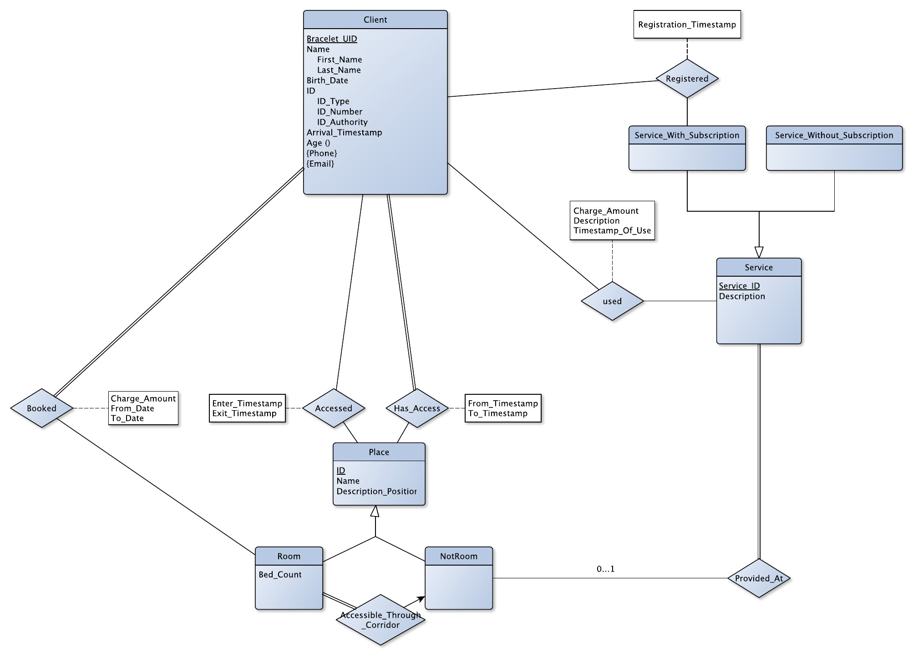
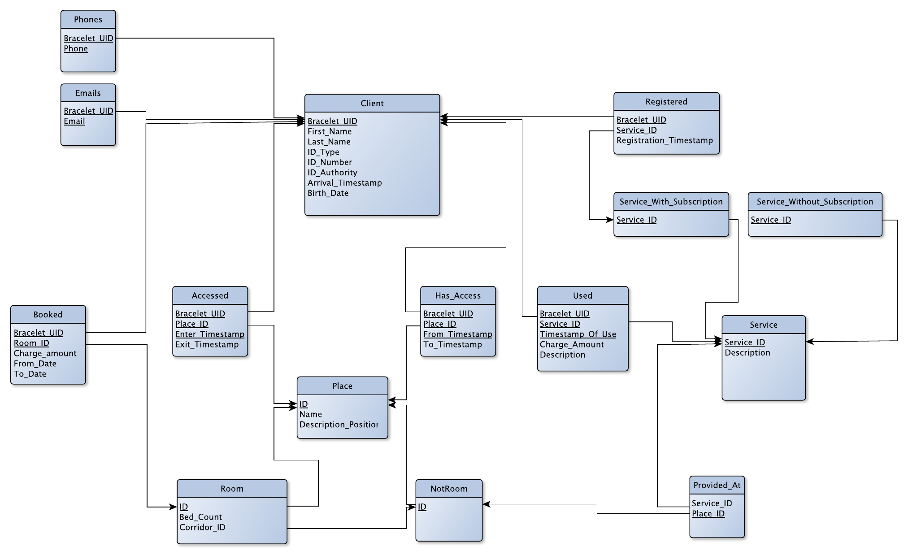

# Hotel Monitoring Database

A relational database and web dashboard for "ASDF Palace", a fictional hotel resort where every guest wears an NFC bracelet. The bracelet records which rooms and facilities a guest enters and which services they use. The system works out who may enter where, records charges, reports on sales and usage, and runs COVID-19 contact tracing.

Built as the semester project for the *Databases* course at the School of Electrical & Computer Engineering, National Technical University of Athens (NTUA), spring 2021.

## Highlights

- **Normalized schema** (MariaDB/MySQL) with ISA hierarchies (Place → Room / NotRoom, Service → with / without subscription), multivalued attributes (phones, emails), `CHECK` constraints (ID documents, phone and email formats) and a generated `age` column.
- **22 triggers** that enforce business rules the schema alone can't:
  - Prevent double-booking a room.
  - Allow a service only where it is offered, and only for guests with access.
  - Grant or revoke access to a room automatically when it is booked or cancelled.
  - Grant access to free facilities on arrival, and to a service's facilities on subscription.
  - Keep each ISA hierarchy consistent when rows are deleted.
- **Views and indexes:** a client-info view (all phones, emails and subscriptions per guest), a per-service sales view, and indexes chosen for the dashboard's time- and charge-range queries.
- **COVID-19 contact tracing:** given an infected guest's bracelet, list every place they visited, and every other guest who was in the same place at the same time or up to one hour after they left.
- **Usage analytics** by age group and time period: the busiest places, the most-used services, and the services used by the most guests.
- **Synthetic data generator** in Python that produces consistent guests, bookings, access logs and service charges.

## Diagrams

**Entity–relationship diagram**



<details>
<summary>Show relational schema</summary>



</details>

## Repository layout

| Path | Contents |
| --- | --- |
| [`sql/`](sql) | `create_tables.sql`, `triggers.sql`, `views_and_indexes.sql`, sample data (`initial_insertions.sql`, then `test_insertions.sql`), and the course queries (`queries.sql`) |
| [`interface/`](interface) | PHP web dashboard (W3.CSS) |
| [`generator/`](generator) | `create_insertions.py` and the name/surname/city lists it samples from |
| [`diagrams/`](diagrams) | ER and relational diagrams (yEd `.graphml` sources, PDF and PNG) |
| [`report/`](report) | Project report (Greek) |

## Running locally

**Requirements:** MariaDB 10.2+ (or MySQL 8.0.16+) and PHP with the `mysqli` extension. XAMPP or a similar bundle works.

1. **Create and load the database.** The generated data uses `0` as a valid ID in auto-increment columns, so load it with `NO_AUTO_VALUE_ON_ZERO` enabled. phpMyAdmin's import enables this by default. From the command line:
   ```sh
   mysql -u root -e "CREATE DATABASE ASDF_DB CHARACTER SET utf8mb4"
   for f in create_tables triggers views_and_indexes initial_insertions test_insertions; do
     mysql -u root --init-command="SET SESSION sql_mode=CONCAT(@@sql_mode,',NO_AUTO_VALUE_ON_ZERO')" ASDF_DB < sql/$f.sql
   done
   ```
2. **Configure the connection** in [`interface/sql_connector.php`](interface/sql_connector.php). It defaults to `root` with no password on `localhost`.
3. **Start the dashboard:**
   ```sh
   php -S localhost:8000 -t interface
   ```
   and open <http://localhost:8000>.

The sample data comes from the generator: `cd generator && python3 create_insertions.py` prints a complete random dataset to stdout. Timestamps are relative to the current date, so each run gives different arrival and usage times. The committed files split one such run: places and services are in `initial_insertions.sql`, and guests, bookings and logs are in `test_insertions.sql`, followed by hand-written rows for the contact-tracing demo.

### Dashboard pages

The interface text is in Greek. The pages are:

| Page | What it shows |
| --- | --- |
| Υπηρεσίες (Services) | Search service usage by date range, charge range and service |
| Πωλήσεις (Sales) | Sales totals per service (`ServiceSales` view) |
| Πελάτες (Clients) | Guest details with phones, emails and subscriptions (`Client_Info` view) |
| COVID-19 → Επισκόπηση (Overview) | Busiest places and most-used services by age group, over the last month or year |
| COVID-19 → Ιχνηλάτηση (Tracing) | Places an infected guest visited, and the guests who may have been exposed |

## Authors

- **Leonidas Delimpasis** ([@socah](https://github.com/socah))
- **Panagiotis Menegakis** ([@PanosMenEl18052](https://github.com/PanosMenEl18052))
